# mwm2

<p align="center">
  
</p>

Smoother window moving and resizing for macOS 14+.

## Move

Hold left ⌥ and drag from anywhere in a window. Edges snap to the screen and other windows.


## Tile

Drop on a screen edge: half, quarter in a corner, full at the top.


## Maximize

Double-click to fill the screen, again to put it back.


## Resize

Right-drag. The half you grab picks the edge. It stays on its screen.


## Two displays

The edge between displays doesn't tile, so windows cross it freely.


## Cancel



## Demos

The animations are built from `docs/scenes` with [svjeez](https://github.com/saiashirwad/svjeez). They replay a script of cursor moves and key presses through a port of mwm2's drag logic, so they only show what mwm2 does. Rebuild with `make demos`.

## Install

```sh
make install
```

Then enable mwm2 in System Settings → Privacy & Security → Accessibility.

Uninstall with `make uninstall`.
