# mwm2

<p align="center">
  
</p>

Smoother window moving and resizing for macOS 14+.

Hold **Left Option**, then:

- **drag** to move a window. Edges snap to the screen and other windows; drop on a screen edge to tile it to a half, a quarter in a corner, or the full screen at the top.
- **right-drag** to resize it with an outline, kept to its screen and applied on release.
- **double-click** to maximize it, and again to restore it.
- press **Escape** or the other mouse button mid-drag to cancel.

```sh
make install
```

Then enable mwm2 in System Settings > Privacy & Security > Accessibility. Remove it with `make uninstall`.
