# mwm2

<p align="center">
  
</p>

Smoother window moving and resizing for macOS 14+.

## Move

Edges snap to the screen and other windows.


## Tile

Drop on a screen edge: half, quarter in a corner, full at the top.


## Maximize


## Resize

The half you grab picks the edge. It stays on its screen.


## Cancel



## Install

```sh
make install
```

Then enable mwm2 in System Settings → Privacy & Security → Accessibility.

Uninstall with `make uninstall`.
